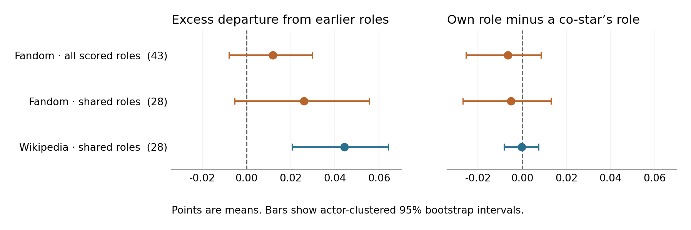

# Nolan casting with Fandom character descriptions

The expanded collection adds 47 character descriptions and brings the same-film comparison to 52 roles and 27 actors. It also includes a separate index of Cornell screenplay dialogue. The results below document the original 320-description collection. [Expanded data and results](expanded/README.md)

Using the paper’s TF–IDF measure across **43 Nolan roles played by 21 actors**, a character's own description was about as far from the actor's earlier work as a co-star's description from the same film. The mean difference was **−0.0064** in cosine-distance units (actor-clustered 95% interval −0.0254 to +0.0084, two-sided permutation *p* = 0.49). Positive values would support casting against type.

## Coverage

The November 25, 2026 collection started with all 2,639 credits in the paper’s text roster, including credits where Wikipedia had yielded no passage. Searches covered all 88 actors and produced 726 candidate pages across seven Fandom communities. Page titles, portrayal evidence and film context were checked before selection. Where several performers played different ages of one character, a general biography could not be attributed to an individual performance.

| Role group | Credits in the paper’s roster | Usable Fandom descriptions | Coverage |
|---|---:|---:|---:|
| Nolan | 142 | 97 | 68.3% |
| Other directors | 2,497 | 223 | 8.9% |
| Total | 2,639 | 320 | 12.1% |

The 320 passages come from 293 source articles and cover 81 actors, 227 films and all 13 Nolan films. Sixteen additional credits had an attributable passage below the word threshold. The other 2,303 have empty text in the released corpus. A missing entry means this search produced no verified extract. The median passage length was 197 words for Nolan and 256 for other directors.

## The same tests on two sources

The analysis uses the paper’s name masking, TF–IDF vectorizer, 25-word minimum and three strictly earlier comparison roles. For each held-out earlier role, both that role and the target are compared with the same centroid. Excess departure is the target’s distance minus the held-out role’s distance, averaged over held-out roles. The same-film comparison subtracts the mean excess departure of eligible co-stars scored against that same actor’s history. Tests use 10,000 actor-clustered sign flips and intervals use 5,000 actor-clustered bootstrap draws. [Paper methods](../paper/main.tex) · [Per-role Fandom scores](results/fandom_scores.csv)

| Text and sample | Scored Nolan roles / actors | Excess departure (*p*) | Own minus co-star (*p*) |
|---|---:|---:|---:|
| Wikipedia plots, full paper | 82 / 55 | +0.0234 (≈0.0001) | +0.0008 (0.80) |
| Fandom, full collection | 43 / 21 | +0.0119 (0.26) | −0.0064 (0.49) |
| Wikipedia plots, shared credits | 28 / 15 | +0.0442 (0.0024) | −0.0002 (0.97) |
| Fandom, shared credits | 28 / 15 | +0.0260 (0.18) | −0.0051 (0.65) |

Both shared-credit runs use the same 239 actor–film credits, each with a usable description from both sources. The target roles, available earlier roles and eligible co-stars are matched. Each source gets its own fitted TF–IDF vocabulary. Changing source moved the co-star difference by −0.0049 (95% interval −0.0239 to +0.0107, *p* = 0.60). The corresponding change in excess departure was −0.0182 (−0.0377 to +0.0058, *p* = 0.17). These paired comparisons account for the difference in coverage between the original and Fandom samples. [Numerical results](results/comparison.json)



## What the character descriptions pick up

- **Holding the actor fixed across directors.** For the 15 actors with scorable roles in both groups, mean Nolan excess departure exceeded the same actor’s mean under other directors by +0.0105 (*p* ≈ 0.40). The paper’s original estimate was +0.0165 over 52 actors (*p* = 0.0002). With Fandom, only three other directors reached three scored roles. [Director results](results/director_test.json)
- **Ranking the actor against other actors.** With types based on three earlier roles each, the cast actor’s mean percentile was 0.559 for their own Nolan role and 0.552 for a co-star’s. The paired difference was +0.008 (*p* = 0.82). For films by other directors, only six roles had a co-star for the departure test and five for the ranking test. [Numerical results](results/comparison.json)
- **Returning actors.** Nine actors had enough text for the size-matched comparison of distinct characters. Their Nolan characters had mean pairwise cosine 0.014 versus 0.041 for their other roles (*p* = 0.063). A separate comparison of 34 character pairs from 14 actors against co-stars in the same two Nolan films gave a difference of −0.0059 (*p* = 0.23). [Returning-actor results](results/within_nolan.json) · [Co-star controls](results/paper_checks.txt)
- **Recognizing a reprised character.** Across 13 reprises by eight actors, the new passage was closer to the same character’s earlier passage than a co-star’s passage was (cosine 0.109 versus 0.058, *p* = 0.033). All 13 comparisons used distinct sections of the same Fandom article for the two appearances. Shared authorship and vocabulary can contribute to that signal. [Reprise tests](results/paper_checks.txt) · [Source selections](sources.csv)
- **Link to the casting network.** Over 77 film pairs, shared cast size correlated weakly with film-text similarity after the shared actors’ passages were removed (Spearman ρ = 0.14, Mantel *p* = 0.47). [Film network](results/link_film_network.json) · [Network position](results/link_regulars.json) · [Co-star similarity](results/link_homophily.json)

## Text quality and sensitivity

The selection favoured article introductions and personality sections. When there was too little descriptive prose, the corpus could use character biography. For a character spanning several films or adaptations, a passage had to be attributable to the credited film. The primary corpus contains 164 introduction/personality selections, 94 film-section selections and 62 biography selections. Formatting, actor credits and standard film-identification boilerplate were cleaned before the paper's masks were applied. The source manifest fixes the revision and the individual paragraphs. For example, Arthur’s page describes how he works, while Alfred’s article has distinct sections for his appearances in the Batman films. [Arthur](https://inception.fandom.com/wiki/Arthur?oldid=14844) · [Alfred Pennyworth](https://batman.fandom.com/wiki/Alfred_J._Pennyworth?oldid=270766)

Three checks bear directly on the interpretation.

| Fandom selection | Nolan roles / actors with a co-star | Own minus co-star | *p* |
|---|---:|---:|---:|
| Introductions and personality selections only | 11 / 9 | −0.0061 | 0.52 |
| Heroes Wiki and Villains Wiki for both Nolan and earlier roles | 18 / 12 | −0.0057 | 0.68 |
| First 40 words of every eligible passage | 38 / 20 | +0.0074 | 0.048 |
| First 60 words | 31 / 17 | +0.0039 | 0.45 |
| First 80 words | 30 / 17 | +0.0044 | 0.33 |
| First 100 words | 26 / 16 | +0.0041 | 0.40 |
| First 120 words | 25 / 16 | +0.0019 | 0.68 |

The 40-word result is the one length cutoff at which the co-star comparison crosses 0.05, among five cutoffs examined. Truncation also changes which roles qualify. The 60–120-word analyses and the full passages give little support for a persistent difference. [All specifications](results/comparison.json)

All 223 earlier/comparison passages came from Heroes Wiki or Villains Wiki. These communities select for protagonists and antagonists. Most Nolan passages came from film-specific communities, and even character pages often recount plot. The general-wiki check uses 18 alternative, attributable character passages plus the primary selections from those communities. The matched-credit comparison addresses role availability, while the general-wiki check addresses editorial source. A new blind human rating exercise would be needed to establish whether readers judge character similarity more accurately from these descriptions. The paper’s ratings apply to the original plot passages.

## Does a sentence encoder recognize similar characters?

TF–IDF rewards shared vocabulary. The Week 7 sentence encoder can also match passages that express similar ideas in different words. I ran both measures against the team’s existing reader scores, then repeated the same-film Fandom comparison with the encoder. Longer passages were split into contiguous chunks within the model’s input limit and given equal weight. [Course methods, §§47 and 51](../METHODS.md) · [MiniLM model card](https://huggingface.co/sentence-transformers/all-MiniLM-L6-v2)

| Comparison | TF–IDF | MiniLM |
|---|---:|---:|
| Agreement with readers, 18 within-actor Wikipedia pairs (Spearman ρ) | 0.04 | 0.09 |
| Agreement with readers, including five deliberately high-TF–IDF same-film pairs (23 pairs) | 0.26 | 0.24 |
| Own minus co-star distance, 43 Fandom roles and 21 actors | −0.0064 (*p* = 0.49) | −0.0359 (*p* = 0.032) |

The correlations use full-precision scores. Rounding TF–IDF to the four decimal places in the original validation file produces ties and gives ρ = 0.00 on the 18 within-actor pairs. These pairs were sampled across TF–IDF score ranges and received one reader rating each. Neither model closely tracked the readers on those pairs. None of the 18 pairs has both passages in the Fandom corpus. [Original validation key](../validation/validation_key.csv) · [Pilot results and worksheet key](results/semantic_pilot.json)

MiniLM placed the actor’s own Nolan character closer to their prior roles than a co-star from the same film was, with a 95% actor-cluster bootstrap interval of −0.0710 to −0.0058. An exploratory check restricted each role’s co-stars to articles from the same Fandom community as that role. The direction persisted across the 38 roles and 19 actors that still qualified (−0.0320, two-sided actor sign-flip *p* = 0.059). This restriction addresses how the candidates were described. Earlier roles still come exclusively from Heroes Wiki and Villains Wiki. The smaller *p*-value in the full MiniLM analysis measures the casting contrast under that model. Reader agreement is a separate question. [Pilot results](results/semantic_pilot.json)

Two readers can use separate copies of the worksheet to judge 21 comparisons independently, one per eligible actor. Each item supplies one earlier role and two masked characters from the same Nolan film. Choose which character is more similar in goals, conduct and relationships, with options for a tie or insufficient evidence. The three excerpts come from distinct articles and were selected without consulting either model. Both models scored the exact excerpts shown. Report how often the readers agree, how often they abstain, and each model’s agreement on the cases where both readers chose the same candidate. If the readers agree and both models frequently miss their choice, report the human comparison directly. The worksheet tests similarity to **one** earlier role. The casting estimate above uses each actor’s available earlier roles together. [Blinded worksheet](blind_character_comparisons.md)

## Reproduction and attribution

Run from the `Final project` directory with Python 3.10 or later. The primary analysis uses Python’s standard library. The standalone paper checks and figure also use NumPy, SciPy, NetworkX and Matplotlib. The collector and corpus builder use Requests and Beautiful Soup.

```sh
python3 fandom/analyze.py
python3 fandom/paper_checks.py
python3 fandom/plot.py
```

Run `python3 fandom/semantic_pilot.py` for the Week 7 comparison. It additionally uses PyTorch and Transformers and downloads the pinned encoder on first use. Supply `--model-dir /path/to/model` for an offline copy. Library versions and the model revision are recorded with the results. [Pilot script](semantic_pilot.py)

[passages.csv](passages.csv) contains the original roster, missingness, raw and masked Fandom prose, and article and revision URLs. Its `wiki_page` field is inherited film metadata for the original director lookup. The text source for each usable passage is `revision_url`. [sources.csv](sources.csv) contains the accepted actor, film, year, character, source selection, paragraph indices and digest. [general_wiki_alternatives.csv](general_wiki_alternatives.csv) holds the extra passages used for the source sensitivity check. The released CSVs run offline.

To regenerate the extracts from the reviewed revisions, run `python3 fandom/build.py --refresh`. Add `--offline` to replay previously cached responses. The builder checks the SHA-256 digest of every selection and checks for reusing a source paragraph across credits in each corpus. To discover candidates for an expanded collection, run `python3 fandom/collect.py`. Search results go under `data/nolan/raw/fandom-study/`; adding candidates to the corpus requires checking the film, performer and applicable sections. The shared sign-flip helper reports an empty sample at a threshold for which no roles qualify, as happens here at 12 priors.

The source prose is credited to the contributors of the linked Fandom article revisions. All seven communities report CC BY-SA. The extracted and masked text is shared under the applicable source license. The pinned article histories identify contributors, and the manifest identifies the selections and modifications. [Community license records](wiki_licenses.json) · [Fandom licensing](https://www.fandom.com/licensing)
